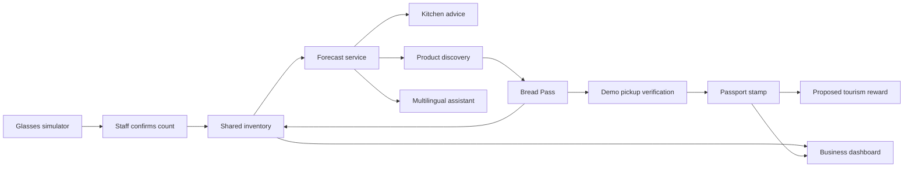

# Technology Research and MVP Design
## Team Avengers — Dongguk University
### Enterprise 4.0 and Business Model Innovation · Two-week practicum

## Our business idea
**Company:** Sungsimdang, a destination bakery in Daejeon, South Korea. It is the proposed first customer, not a confirmed client.

**Product:** Sungsimdang Passport (성심당 패스포트).

**Main message:** Know Before You Go.

**Core philosophy:** We keep the queue and remove the wasted trip.

**Problem:** A visitor may travel a long way and find that a wanted product is sold out. The original proposal also addresses resale and one-time visits. We have not yet measured how common these problems are.

**Solution:** Connect staff-confirmed inventory, demand estimates and multilingual visitor guidance. Keep the original Bread Pass reservations and Pilgrim Ledger visit stamps. The goal is less uncertainty, fairer access and more reasons to return. Customers do not pay for premium queue access.

## Deliverable 1 — Selected technologies and reasons

| Technology | What it does | Cost and difficulty | Why it fits this MVP |
|---|---|---|---|
| Staff AI glasses workflow simulator | Shows a shelf, sample detection boxes and counts; staff corrects the count | No glasses or paid recognition service; moderate UI work | Demonstrates how computer vision could support staff without claiming real detection |
| Rule-based demand forecasting | Uses confirmed sample stock, sales speed, time, weekend, weather and KTX scenarios | No training data or API fees; transparent code | Gives stable, testable availability and sell-out estimates in two weeks |
| Multilingual intent assistant | Answers common questions in English, Korean and Japanese using the same forecast | No paid model; limited but manageable scope | Avoids invented stock and gives a consistent classroom demonstration |
| Identity-bound QR reservation | Gives one sample visitor a controlled pass; handles expiry, waitlist and transfer | QR library and browser state; no real SMS or payment | Demonstrates fairness rules and prevents duplicate active demo reservations |
| Digital stamps and rewards | Records one stamp after verified pickup and unlocks a proposed offer | Simple local records; low implementation effort | Shows the loyalty journey without pretending LocalStorage is blockchain |
| React, TypeScript and LocalStorage | Connect pages, business rules and persistent sample data | Open-source tools; no paid service needed to run locally | Suitable for a responsive, interactive prototype |

**Future choices:** Start with a secure database, POS integration and a simple forecasting baseline. Test camera or wearable recognition using labeled shelf images. Add a trained model only if it beats the baseline. A generative assistant must call trusted services for stock figures. Blockchain credentials remain a future option, not a necessary MVP dependency.

**Important limits:** QR alone does not prove identity. Shelf counts are not complete inventory. Forecast percentages are simulated scores, not calibrated probabilities. There are no real reservations, donations, partners or AI glasses in the prototype. Hardware prices and service budgets need actual quotes. See technology-research.md for alternatives, sources and selection trade-offs.

## Deliverable 2 — Core MVP functions and components

The sample system has **3 stores, 12 products and 3 visitors**.

1. **Find Your Bread:** Search in English or Korean, choose a store/date/time, compare estimates, see sell-out predictions and alternative suggestions.
2. **Operations Center:** Simulate a shelf scan, correct visible and backroom counts, save confirmed inventory, review updated demand and kitchen suggestions.
3. **Bakery Assistant:** Ask about products, preferences, timing, stores or Daejeon. Answers use the shared forecast service in three languages.
4. **Bread Pass:** Reserve an eligible item, generate a unique QR, cancel or expire it, assign a released slot to a waiter, or perform one official transfer with a simulated donation record.
5. **Pickup verification:** Simulate the QR scan and enter the visitor’s demo phone code during the pickup window. An expired or transferred pass cannot be redeemed.
6. **My Passport:** Add one stamp after pickup, show visit history and unlock a proposed reward.
7. **Business Dashboard:** Show shared-state inventory updates, passes, expiry, waitlist activity, donations, verified visits and demo repeat-pickup indicators.
8. **Demo Mode:** Switch visitors, advance the clock, change demand scenarios and reset everything. No real waiting is required.

**Technical components:** typed catalog fixtures, inventory observations, stock snapshots, forecast calculations, reservation state transitions, waitlist rules, stamp/reward derivation, intent-based answers, React state and LocalStorage.

**Main flow:** Staff confirms stock → forecast updates → visitor asks about a product → visitor reserves → demo verification → one stamp → proposed tourism reward → dashboard updates.

## Deliverable 3 — Service architecture

React displays the pages. Services enforce the rules. All pages share one state, saved in the browser. The dashboard reads that same state. The proposed production system would add secure APIs, a database, real identity checks, POS records and evaluated AI models. See architecture.md for the two full diagrams and rendered versions.

## Two-week practicum plan
- **Days 1–3:** Review the proposal, list assumptions, prepare interviews and compare technologies.
- **Days 4–5:** Write requirements, architecture and interaction designs.
- **Days 6–9:** Build and connect the five modules.
- **Days 10–12:** Run software tests and planned usability sessions; fix issues.
- **Days 13–14:** Complete documentation and rehearse the five-minute presentation.

This is a proposed student schedule, not a claim that interviews have occurred.

## Validation and business value
Retain the two-week, two-store field pilot and 20 local regular interviews. Use exit surveys for missed products, monitor resale listings, compare access with/without forecasts, and follow an opt-in 60-day panel. Check fairness for residents. Proposed targets are **30% fewer first-choice misses**, **50% fewer resale listings**, and **15 percentage points higher stated return intent**. None has been achieved or measured here.

Potential value includes better production planning, fewer wasted trips, reduced resale opportunities, tourism engagement, aggregated insights and B2B software licensing. Daejeon City and KORAIL are potential partners only. Expansion sequence: Daejeon → other Korean destination bakeries → Kyoto/Japan → Europe. The software model expands; bakery products remain locally sold.

## Source and completion limits
The original business-plan DOCX is still missing. Strategy and six-section traceability are based on the two supplied master specifications and require a final check against that file. Software test evidence is recorded in usability-testing.md. Field research, forecast accuracy, real computer-vision accuracy and real commercial impact remain untested.
