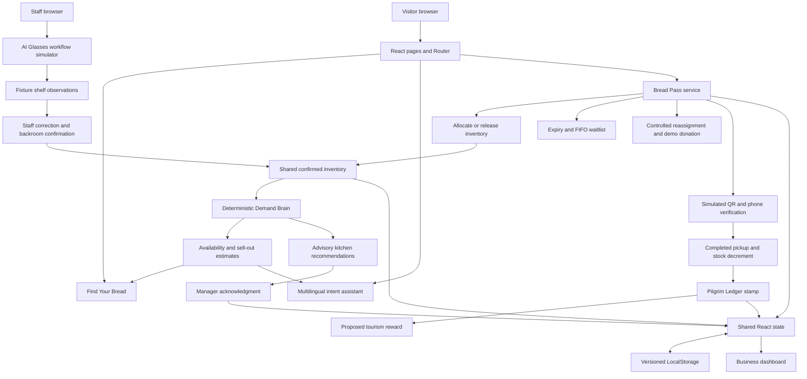
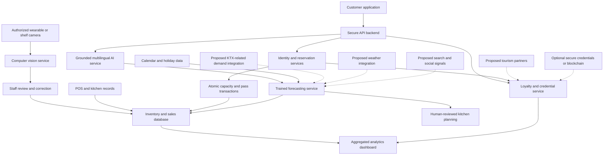

# Service architecture

The two diagrams below distinguish the working browser prototype from a proposed production system. SVG renderings are supplied in `docs/diagrams/` after diagram verification.

## Current functional MVP

All modules operate in one browser. “Staff” and “visitor” are demonstration roles, not access-controlled identities. The state service coordinates the modules; LocalStorage persists that state. There is no server database, trained AI, live camera, real SMS or blockchain.

## Proposed production architecture — not implemented

Future security boundary: authenticated API with authorization, atomic slot allocation, signed short-lived QR tokens, audited reassignment, verified identity provider, consent, retention policies and observability. Raw wearable images should be minimized and access restricted. Partner access and model use require separate agreements and evaluation. The diagram does not claim any existing POS, KTX, weather, tourism or blockchain integration.
